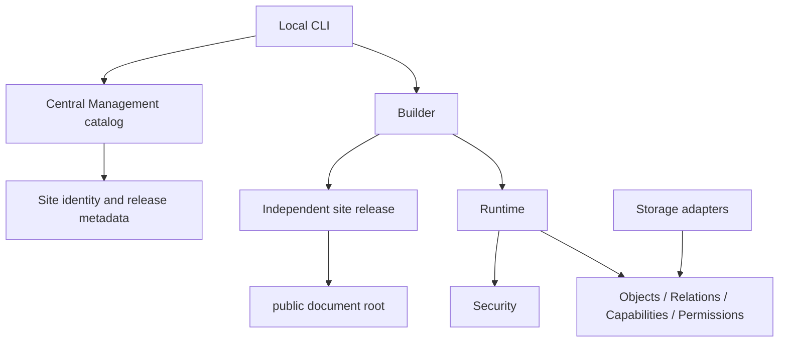

# ONE Engine — Foundation architecture

## Decision and scope

ONE Engine is an independent product, not an arbnt rename. Use a **modular
monolith**: one PHP codebase with explicit namespaces and dependency direction,
without a framework, service network or required dependency manager. PHP 8.3 is
the minimum. HTML/CSS is the default UI; JavaScript is optional.

This release is a vertical foundation slice: a synthetic public page, permission
evaluation, storage contracts and standalone build artifacts. It deliberately
does not port the arbnt community application.

Runtime has **no dependency on Builder or CentralManagement**. Storage is not
yet wired to the synthetic demo page. Future application services depend on
`DocumentStore` and authorize before persistence; adapters never decide access.
The lightweight structural check guards namespace direction, not every possible
dynamic PHP dependency; normal code review still applies.

## Layout

| Path | Responsibility |
| --- | --- |
| `src/Core/` | Immutable object, relation, action, actor, grant and pure policy evaluator |
| `src/Storage/` | JSON and PDO SQLite document adapters, private path checks |
| `src/Security/` | Response header defaults and CSRF primitive |
| `src/Modules/Builder/` | Build a new local release using explicit file allowlists |
| `src/Modules/Runtime/` | Site config, public renderer, exact routes, response handling |
| `src/Modules/CentralManagement/` | In-memory site catalog boundary; no remote management API |
| `public/` | Only web-accessible directory; entrypoint, development router, CSS |
| `config/` | Synthetic site settings and recommended PHP configuration; outside webroot |
| `var/` | Ignored local data location; provisioning must create a private 0700 directory |
| `tests/` | Policy, persistence, concurrency, packaging and real HTTP checks |
| `bin/one` | Local build / synthetic catalog CLI; no deployment command |

## Objects and relations

An object has `siteId`, stable `id`, `type`, `ownerId`, plain UTF-8 title/body,
state (`draft`, `published`, `archived`), visibility (`private`, `public`) and a
list of enabled action capabilities. IDs are opaque to application logic and
validated before storage access. The initial identifier accepts safe 1–64
character ASCII identifiers; future generated IDs can use random hexadecimal.

A relation holds site, source, target and relation type. Construction rejects
cross-site and self relations. It does not prove database existence, authorize
an action, prevent arbitrary graph cycles or implement cascading deletion.
Those rules belong to a future application service and transaction boundary.

Capabilities answer whether an action exists for an object. Permissions answer
whether an actor may use it. Ownership is metadata, not an implicit wildcard.
There is no global admin bypass. See [PERMISSIONS.md](PERMISSIONS.md).

## Three output modes

| Mode | Implemented foundation artifact | Future extension |
| --- | --- | --- |
| Static | HTML, CSS, robots and sitemap; no PHP or datastore | Build published page trees and versioned assets |
| Hybrid | Same static homepage plus local PHP `/health` | Private/user-specific endpoints with explicit auth and no-store |
| Dynamic | Local PHP homepage, SEO and health routes | Authorized content/services rendered from local storage |

Builder writes a staging directory on the destination filesystem and promotes it
to a new directory. Existing directories are refused. `release.json` records the
mode, site, engine version and SHA-256 file inventory. Hashes detect accidental
corruption; they are **not a signature or trusted update channel**. Build and
deploy are separate actions. No uploads, remote commands or VPS changes exist.

For hybrid hosting, the server must prefer `index.html` at `/` and route `/health`
to PHP. The supplied development router demonstrates this; production routing
and headers are an operator responsibility. Switching a site from dynamic to
static cannot make private content public: future export must select public,
published objects through the same policy and never package private storage.

## Site independence and central boundary

Each release includes its own public files, needed runtime code, site metadata
and SEO settings. The foundation builder never reads the storage adapters or
copies the repository wholesale. Central and Builder code, tests, Git metadata,
storage and secrets are absent from releases. No runtime outbound request exists.
Tests boot artifacts outside the source tree without a central service.

Future Central Management owns a site registry, release inventory, explicit
publish jobs and audit trail. A site runtime owns its local data, local security
configuration and operational availability. Central outage must not affect reads
or local authenticated work. Central identity is distinct from site identity;
future management channels need narrowly scoped, revocable credentials and
signed, versioned updates. None of that protocol is implemented in 0.1.0.

## Storage and SEO

JSON is suitable for a small, single-host deployment; SQLite is optional for
local transactional storage. MariaDB can implement the same adapter interface
after shared contract, contention and recovery tests pass. No automatic adapter
fallback may hide data corruption or configuration errors.

Canonical origins come from each site's validated HTTPS configuration, never
`Host` or untrusted proxy headers. Description, robots and sitemap are local to
the site. Demo sites default to `noindex` and empty sitemap; operators opt in
after assigning their own domain. Root-domain hosting only is supported in this
foundation; subdirectory base paths, locale routing and page-specific SEO beyond
the sample homepage are deferred.

## Next boundaries, not current features

Identity/session authentication; content services; policy persistence and role
expansion; page/block editor; mail; moderation; safe media uploads; jobs and
events; migration tools; operational audit and retention; production deployment
integration. Add one reviewed module at a time, with authorization at each entry
point and a compatibility/versioning decision for its persisted data.
