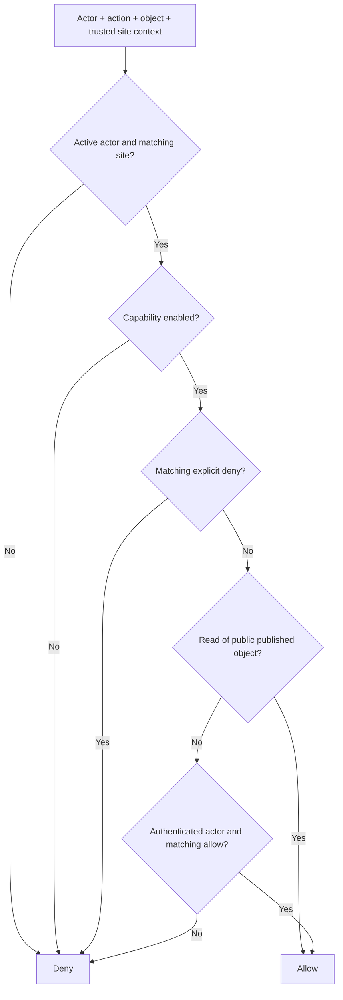

# Permission engine

The foundation implements a small **default-deny** evaluator. It is not yet a
complete identity system or RBAC/ABAC platform. `Principal` and `Grant` objects
must be constructed by trusted application code after authentication and policy
lookup, never deserialized directly from client-provided JSON.

A matching grant has the same site, principal and action; `objectId = null`
means site-wide, otherwise the object ID must match. Explicit deny wins over
allow regardless of order, including a site-wide deny against an object allow.
Unknown actions cannot enter the evaluator because actions are an enum.
Unsupported capability values are rejected at object construction.

| Case | Result |
| --- | --- |
| Anonymous reads published/public object with Read capability | Allow |
| Anonymous reads draft, archived or private object | Deny |
| Owner updates object without grant | Deny |
| Active authenticated principal with matching allow and capability | Allow |
| Inactive principal, foreign-site context or disabled capability | Deny even with allow |
| Matching allow plus explicit deny | Deny |
| Central administrator with no local site grant | Deny |

Ownership-based policy, community membership and roles will expand into explicit
site/object grants in future application services. Relation existence by itself
does not grant access. A private reply/internal note must have its own policy;
access to a parent must never expose private child content implicitly.

The current `Read`, `Update`, `Delete`, `Comment` actions are a foundation
vocabulary, not implemented mutation endpoints. The runtime uses only anonymous
Read; it exposes no authentication or write routes. Future handlers must load
the object under the trusted site context, check capability and permissions,
then perform any state validation and transaction. Recheck relevant policy
inside the same transaction when policy can change concurrently.

Before adding writes: authenticate securely, use strict HttpOnly Secure SameSite
sessions with ID rotation, check CSRF and full configured origin, bound request
bytes and UTF-8 lengths, rate-limit, audit, and escape output. CSRF helper tests
do not imply these future routes are already protected. `config/php.ini` provides
session defaults but 0.1.0 does not start sessions.
